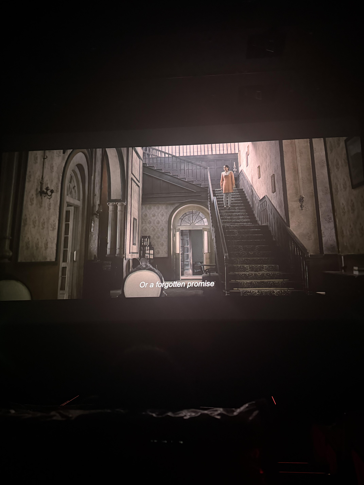

## Doorstep Scene in Mein Wapas Aaunga

*Spoiler alert: skip this if you haven't seen the film and plan to.*

Once in a long while a movie stays with you after the lights come on. This one hasn't left me. Pieces of it come back to me on ordinary days, and suddenly I'm inside the character's life again.

It's a story of unrequited love, set against the partition of India and Pakistan. Ishar is seventeen, living with his family in Pakistan, madly in love with Jia. Then the mobs come. He watches people killed around him, loses his home, loses her, and flees to India carrying wounds no boy that age should carry.

Years later, against every odd, he makes it back for her.

He reaches her house and learns she is married now. Her husband is kind. He tells Ishar how much she suffered after he vanished, and says she would love to see him. Then he goes up to call her.

Ishar stands there for a few seconds. And then he walks away.

The film goes on to show him loving her for the rest of his life, quietly, in pain, until his last breath.

Why did he leave? The door was open. Her husband himself was welcoming him in. The scene has no dialogue and no music, and yet the actor lets you see everything: the war happening inside a man standing perfectly still.

The film leaves it to us. Here is what I believe. He left because he loved her. He understood in those few seconds that meeting her would give them both a moment of joy and leave her with a lifetime of reopened wounds. She had somehow found a way to keep living after losing him, or maybe she was still finding it, and seeing him would put an impossible choice in front of her all over again. He refused to trade her hard-won peace for one sweet moment.

So he took the pain on himself. He let her believe he came all that way and turned back at her doorstep, perhaps out of jealousy, perhaps because his love had thinned. Better that she think a little less of him. Better that she love him a little less, if it helped her hurt a little less.

He walked away so she wouldn't have to.
